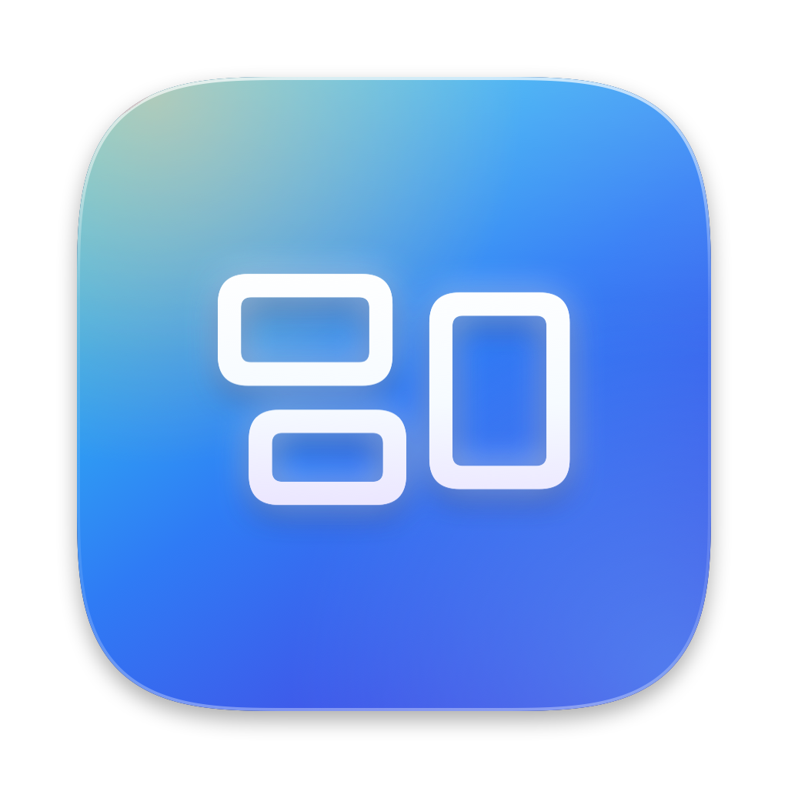

<p align="center"></p>

<h1 align="center">Flowboard</h1>

<p align="center">Every screen of your app on one infinite, read-only canvas, straight from Storybook.</p>

## What it does

Flowboard compiles your stories with `storybook build`, serves the static bundle itself and lays out every story as a live screen on a dotted, pannable, zoomable canvas:

- one row per category (the story `title`, e.g. `Onboarding mobile`), with all its screens side by side;
- stories that are states of the same screen collapse into one screen with ‹ › arrows to switch state;
- categories and screens are named by position, e.g. `1 Accesso` and `1.1 Welcome`; clicking a name copies its id (`1.accesso`, `1.1.welcome`);
- every screen rendered at the size of the selected device (the Chrome DevTools device list);
- screens are real renders of your code: tap, type and scroll in them as in Storybook, then ↺ resets the screen to how it first loaded (its storage too);
- nothing in the board itself can be edited;
- no Storybook dev server: when a source file changes, Flowboard rebuilds and the canvas refreshes by itself.

Designed for Storybook 7+ projects, including React Native through `@storybook/react-native-web-vite`. Storybook must already be installed and configured. Use a `node_modules` installation; Yarn Plug'n'Play is not supported.

## Usage

After publication on npm, run this from the folder containing your `package.json` and `.storybook` config:

```sh
npx flowboard@latest init --open
```

`init` detects npm, pnpm, Yarn or Bun from `packageManager` or a lockfile, including at a parent workspace root. It installs Flowboard as a development dependency and adds `"flowboard": "flowboard --open"` to your scripts. It preserves existing scripts and refuses to overwrite a different `flowboard` script. Re-running it is safe. Custom `--config-dir`, `--port` and `--no-watch` options are saved in the script; config paths are relative to the project. With `--open` it also starts the dashboard. Without `--open` it only sets up the project.

Start it again with:

```sh
npm run flowboard    # or pnpm/yarn/bun run flowboard
```

For a manual installation:

```sh
npm install -D flowboard
npx flowboard --open
```

For a one-off run without adding a project dependency:

```sh
npx flowboard@latest --open    # dashboard on http://localhost:6007
```

| Option | Default | |
|---|---|---|
| `-p, --port <port>` | `6007` | Dashboard port |
| `-c, --config-dir <dir>` | `.storybook` | Storybook config folder |
| `--no-watch` | off | Build once, do not rebuild on changes |
| `-o, --open` | off | Open the dashboard in the browser |

Builds are cached in `node_modules/.cache/flowboard`, so the last build shows up at once while a fresh one runs.

The `init` and registry installation commands require an npm release. Before publication, create a package with `npm pack` in the Flowboard checkout, then run these commands in your target project:

```sh
npm install -D /absolute/path/to/flowboard-0.1.0.tgz
npx flowboard init --open
```

The tarball is a real installation, independent of the source checkout. To test another local release, install its new tarball. You can also run directly from a checkout with `node /absolute/path/to/flowboard/bin/flowboard.js --open`.

## Updates

Flowboard stays in `node_modules`; its dashboard source is never copied into your project. Commit your `package.json` and lockfile to share the same version with your team. Updates are explicit:

```sh
npm update flowboard                  # within the declared version range
npm install -D flowboard@latest       # latest release, including breaking changes
npx flowboard --version
```

For pnpm, Yarn and Bun, use their corresponding update commands. Stop and restart Flowboard after updating. A dependency installed from a local tarball must be replaced with a new tarball or a registry version first.

Releases use semantic versioning. During `0.x`, minor releases can include breaking changes; patches remain compatible. From `1.0`, breaking changes increment the major version. Flowboard never updates itself automatically.

## Releasing

Run from a clean `main` checkout with an authenticated npm account authorized to publish `flowboard`. The package currently uses `UNLICENSED`, so distribution does not grant an open-source license.

1. Run `npm test` and `npm pack --dry-run`. Test the generated tarball in a separate Storybook project before publishing.
2. For subsequent releases, run `npm version patch`, `npm version minor` or `npm version major` and add release notes on GitHub. The initial version is `0.1.0`.
3. Run `npm publish --access public`. The `prepublishOnly` script runs the tests again. npm may require account authentication or 2FA.
4. After a successful publication, push the release commit and tags with `git push origin main --follow-tags`. Users can then install or update to the new version.

The first publication reserves the package name, subject to npm availability and policy. Never include credentials or local build artifacts in a release.

## Screen states

Inside one category, stories collapse into a single screen when:

- they share a leading number: `02 · Home name` and `02 · Home name empty`;
- or one name is another plus a state word: `Dashboard` and `Dashboard Empty`, `Loading`, `Error`… (see `STATE_WORDS` in [dashboard/screens.js](dashboard/screens.js)).

`Create` and `Create Rooms` stay two screens: `Rooms` is not a state word.

Names and ids follow the story order: they change when stories are added or reordered. Storybook's own story id (e.g. `accesso--welcome`) stays stable.

## Canvas controls

| Action | Trackpad | Mouse / keyboard |
|---|---|---|
| Pan | two-finger scroll, or drag on the empty canvas | drag the empty canvas, or drag with the middle or right button anywhere, or wheel |
| Use a screen | click, type, two-finger scroll over it | click, type, wheel over it |
| Reset a screen | | ↺ next to its name |
| Zoom | pinch | ⌘/Ctrl + wheel, `+` / `-` (10% steps) |
| 100% | | `0` |
| Fit all screens | | `1` |

Scrolling a screen stops at its top and bottom, without moving the canvas. A screen that focuses an input by itself does not take the keyboard; one you clicked into keeps it until you click the canvas.

## How it works

- Screens are iframes of the static Storybook bundle, served from the other loopback name (`127.0.0.1` when the dashboard is on `localhost`). Being another site, they run in a separate browser process, so their JavaScript never stalls panning and zooming.
- [dashboard/frame.js](dashboard/frame.js) is injected into every screen. It reports when a story has rendered, so screens boot four at a time; hands ⌘/Ctrl+wheel zooms and middle/right drags begun over the screen to the canvas; and clears the screen's storage on reset.
- Each state of a screen is its own iframe, stacked in the same frame. A state is shown only once it has rendered, so switching never flashes blank, and switching back is instant. Reset loads a fresh iframe underneath the same way.
- The server only answers `localhost` / `127.0.0.1` requests from this machine.

## Requirements

Node 20+. No dependencies. Tests: `npm test`.
